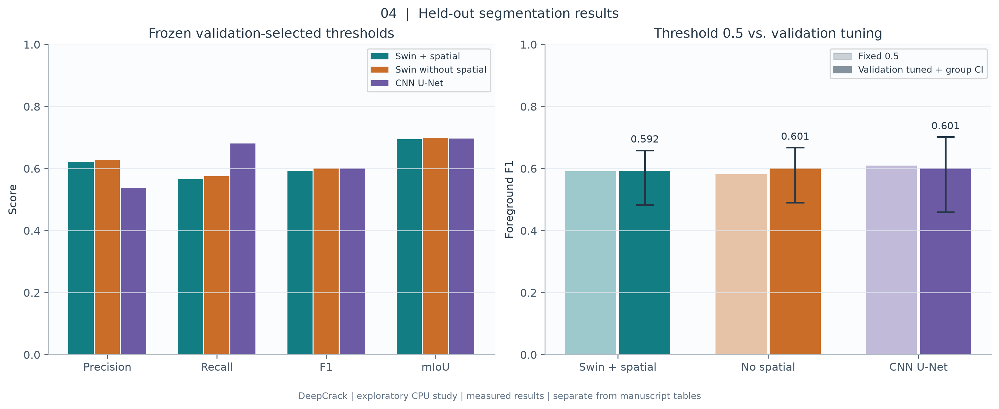
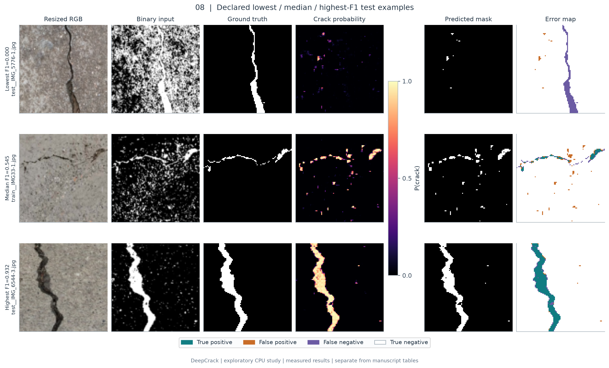

# Crack Vision Net

**A manuscript-based implementation of Swin U-Net with spatial attention for pavement crack segmentation.**

We implemented the transformer encoder–decoder, preprocessing, training, evaluation, inference, dataset checks and experiment workflows described in *Crack Vision Net: An AI Enabled Vision Sensing Framework for Pavement Crack Detection in Intelligent Transportation Systems*. We tested the software and recorded measured execution reports. The implementation decisions that complete the manuscript's specification are documented in [the method map](docs/METHOD_MAPPING.md).

The system predicts a binary crack mask and probability map from a road image. Four crack categories can be carried as dataset metadata for subgroup evaluation. The source manuscript and research datasets remain outside public source control.

## Research results and figures

We extended the project with a matched three-model DeepCrack study, ten scientific figures, numerical result tables and an editable Word report. The exploratory runs use 15 epochs and compact 96×96 models; they are separate from the manuscript's full-model, five-dataset protocol.

**[Read the detailed results report](docs/RESEARCH_RESULTS.md)** · **[Download the Word report](docs/RESEARCH_RESULTS.docx)** · **[Open the ten-figure PDF](figures/research_figures.pdf)** · **[Reproduce the study](docs/EXPERIMENT_GUIDE.md)**





| Figure | Research question |
|---|---|
| [1. Learning curves](figures/01_learning_curves.png) | How do training and validation losses evolve? |
| [2. Validation dynamics](figures/02_validation_dynamics.png) | How do F1, mIoU and learning rate change? |
| [3. Dataset composition](figures/03_dataset_composition.png) | How many images/groups are held out, and how imbalanced are labels? |
| [4. Segmentation results](figures/04_segmentation_results.png) | How do the measured operating points and uncertainty compare? |
| [5. Precision–recall](figures/05_precision_recall.png) | How well do probabilities rank foreground pixels? |
| [6. Threshold selection](figures/06_validation_thresholds.png) | Which thresholds maximize validation F1? |
| [7. Confusion matrices](figures/07_confusion_matrices.png) | Which class errors dominate? |
| [8. Qualitative predictions](figures/08_qualitative_predictions.png) | What do lowest-, median- and highest-F1 examples look like? |
| [9. Robustness checks](figures/09_robustness_tests.png) | How do controlled image perturbations affect predictions? |
| [10. Efficiency](figures/10_efficiency_comparison.png) | What are the measured CPU speed, parameter count and accuracy tradeoffs? |

PNG and SVG versions accompany every figure. The captions explain axes, sample selection, operating thresholds, uncertainty and interpretation. [Machine-readable results](reports/research_cpu/results.csv) and [full analysis](reports/research_cpu/analysis.json) retain measured values and provenance.

```bash
pip install -e '.[test,research]'
python scripts/run_research_study.py --manifest data/deepcrack/manifest.csv \
  --runs runs/research_cpu --analysis reports/research_cpu --figures figures
```

## What we implemented

- A four-stage hierarchical Swin encoder and matching U-shaped decoder, with relative position bias, masked shifted windows, patch merging/expansion, skip fusion and spatial attention gates.
- A configurable CNN U-Net comparison model, BCE–Dice training, separate BCE/Dice/focal losses and nine controlled ablation variants.
- Grayscale/denoising/Otsu preprocessing, an optional morphological black-hat path and joint image/mask augmentation.
- Checksum-pinned DeepCrack acquisition; a common data interface for all five datasets; source-group splits, annotation validation and leakage checks.
- Training with Adam and the manuscript's learning-rate schedule, validation-selected checkpoints and resumable optimizer/scheduler/random-generator state.
- Pixel precision, recall, F1, accuracy, crack IoU, background IoU, mIoU, per-category and per-image reports, and a bounded-memory pixel precision–recall curve/AP approximation.
- Original-resolution and overlapping-tile inference, probability arrays, binary masks and image overlays.
- Synchronized latency benchmarking, per-dataset and cross-dataset experiments, summary CSV export and automated checks.

## Install

Python 3.10 or newer is required. We executed the local validation with Python 3.12 and CPU PyTorch; the tested package versions are in [reports/validated_environment.txt](reports/validated_environment.txt).

```bash
git clone https://github.com/mawaisashraf3/sensor.git
cd sensor
python -m venv .venv
source .venv/bin/activate
python -m pip install --upgrade pip
# CPU build, also suitable for the small demonstration:
pip install torch --index-url https://download.pytorch.org/whl/cpu
pip install -e '.[test]'
pytest -q
```

For GPU experiments, install the PyTorch build matching your CUDA driver using the [official PyTorch instructions](https://pytorch.org/get-started/locally/), then install this package. `--device auto` selects CUDA when present; `--device cpu` makes the choice explicit. The primary configuration is intended for a GPU comparable to the manuscript's RTX3090. Adjust batch size for memory capacity and record the change.

## Run a complete demonstration

```bash
crackvision synthetic --out data/smoke --count 40 --size 96
crackvision audit --manifest data/smoke/manifest.csv
crackvision train --config configs/smoke.yaml \
  --manifest data/smoke/manifest.csv --out runs/smoke --device cpu
crackvision evaluate --checkpoint runs/smoke/best.pt \
  --manifest data/smoke/manifest.csv --out runs/smoke/test_metrics.json --device cpu
crackvision infer --checkpoint runs/smoke/best.pt \
  --image data/smoke/images/0000.png --out runs/smoke/prediction \
  --tile 64 --overlap 16 --device cpu
crackvision benchmark --checkpoint runs/smoke/best.pt \
  --out runs/smoke/benchmark.json --iterations 30 --device cpu
```

The generator creates procedural crack-like patterns across four categories. These fixtures verify the pipeline; their scores do not estimate road-image accuracy. `configs/smoke.yaml` uses a small model and two epochs. The primary architecture and 50-epoch protocol live in `configs/manuscript.yaml`.

## Prepare research data

```bash
# Author-hosted DeepCrack archive, pinned by SHA-256:
python scripts/fetch_deepcrack.py --out data/deepcrack

# Other datasets: matching image/mask stems and a source-group table:
crackvision prepare --images /path/images --masks /path/masks \
  --groups /path/groups.csv --dataset 4TRCD \
  --out data/4trcd/manifest.csv --seed 42
crackvision audit --manifest data/4trcd/manifest.csv
```

See [DATASETS.md](docs/DATASETS.md) for acquisition references, schemas, source-group handling, annotation rules and RDD2022 pixel-mask requirements. The adapter records upstream provenance and makes an explicitly named new split. It namespaces upstream train/test filenames because some stems recur in both folders. Existing official splits can be encoded directly in a CSV and audited. The default splitter targets 60/10/30 at group level and stratifies groups by category; realized image proportions can differ.

## Train, test and resume

```bash
crackvision train --config configs/manuscript.yaml \
  --manifest data/deepcrack/manifest.csv --out runs/deepcrack --device auto
crackvision evaluate --checkpoint runs/deepcrack/best.pt \
  --manifest data/deepcrack/manifest.csv --split test \
  --out runs/deepcrack/test_metrics.json

# Continue the same experiment after interruption:
crackvision train --config configs/manuscript.yaml \
  --manifest data/deepcrack/manifest.csv --out runs/deepcrack \
  --resume runs/deepcrack/last.pt
```

Adam starts at 0.0002; StepLR halves the rate after each 10 completed epochs. The primary loss is 0.5 BCE + 0.5 Dice. Validation mIoU selects `best.pt`. Training never selects checkpoints using test scores. The run directory stores configuration, data audit, environment, history and checkpoints. Existing runs are protected against accidental overwrite. Resume verifies configuration, manifest bytes and a dataset content fingerprint; keep dataset content immutable during a run. Only load checkpoints from trusted sources.

Default inference threshold is 0.5. Any threshold selection should use validation data only, then remain fixed for test. Evaluation resizes images/masks to the configured square size, using bilinear/nearest interpolation respectively. Full-resolution tiled inference is a separate deployment path; do not compare its outputs to resized benchmark metrics without stating the protocol.

## Inference and deployment measurements

```bash
crackvision infer --checkpoint runs/deepcrack/best.pt \
  --image /path/road.jpg --out runs/road_prediction --tile 512 --overlap 64
crackvision benchmark --checkpoint runs/deepcrack/best.pt \
  --out runs/deepcrack/benchmark.json --iterations 100 --warmup 10
```

Prediction outputs are `probability.npy` (float32), `mask.png`, `overlay.png` and `prediction.json`. With `--tile 0`, the model processes the entire original image; tiling blends overlapping probabilities uniformly. Preprocessing uses the whole image before tiling to keep thresholding consistent. Tile context and window alignment can change boundary predictions. A pixel fraction indicates segmented area in image coordinates; physical crack width/severity needs calibration.

Benchmark results include mean/median/p95 milliseconds per image and FPS for batch-one forward passes, with CUDA synchronization where applicable. They exclude disk access, preprocessing and serialization. Report the input size, model configuration, device and measurement scope alongside any speed claim.

## Controlled experiments

```bash
# Full, no spatial attention, BCE, Dice, focal, RGB, gray, black hat, CNN U-Net:
crackvision ablate --config configs/manuscript.yaml \
  --manifest data/deepcrack/manifest.csv --out runs/ablations

# Edit a local copy of the five-dataset map first:
cp configs/datasets.example.yaml configs/datasets.local.yaml
crackvision suite --config configs/manuscript.yaml \
  --datasets configs/datasets.local.yaml --out runs/five_datasets
crackvision summarize --root runs --out runs/results.csv
```

`suite` trains one model per dataset and evaluates its best checkpoint on every target test set, producing a generalization matrix. Target-domain test sets must also be disjoint from source training data across collections; the suite rejects exact decoded-image overlap across collections, while acquisition metadata is still needed to establish scene independence. All models use the same binary mask definition. For statistical comparisons, run the same splits at multiple declared seeds, report distribution/uncertainty, and reserve test data for final measurement. A single seed is sufficient only for execution checks.

## Repository layout

```text
configs/                 Primary/small configurations and dataset map
src/crackvision/
  model.py               Swin hierarchy, attention and CNN U-Net
  data.py                Manifests, checks, preprocessing and fixtures
  losses.py              BCE, Dice, hybrid and focal
  metrics.py             Accumulated pixel confusion metrics
  engine.py              Train/evaluate/infer/benchmark/provenance
  cli.py                 Unified experiment commands
scripts/                 Checksum-pinned dataset adapter
tests/                   Numerical, data-integrity and workflow checks
docs/                    Scientific mapping, dataset guide, model card
reports/                 Measured execution reports and their scope
.github/workflows/       CPU checks and demo workflow
```

## Research status

We completed software implementation, numerical/data checks, executable workflow validation and the exploratory three-model study illustrated above. [VALIDATION.md](docs/VALIDATION.md) records the precise runs performed. The full 256×256 architecture also passed a CPU forward/backward check with finite gradients.

Full 50-epoch RTX3090 experiments across the five original datasets, author-provided 4TRCD images/annotations, RDD2022 pixel ground truth, and comparisons against the cited original baseline implementations remain the requirements for reproducing the paper's tables. The manuscript contains conflicting split counts, backbone descriptions and some metric/timing entries; [METHOD_MAPPING.md](docs/METHOD_MAPPING.md) records how we resolved the implementation choices. Measured reports use their own provenance and do not claim reproduction of those paper tables.

## Citation and license

See [CITATION.cff](CITATION.cff) and [references.bib](references.bib). Cite the source manuscript when its final bibliographic metadata is established, and cite each dataset/method used. Original implementation code is distributed under the [MIT license](LICENSE); upstream datasets and the manuscript retain their own terms. See [CONTRIBUTING.md](CONTRIBUTING.md) for reproducible contributions.
