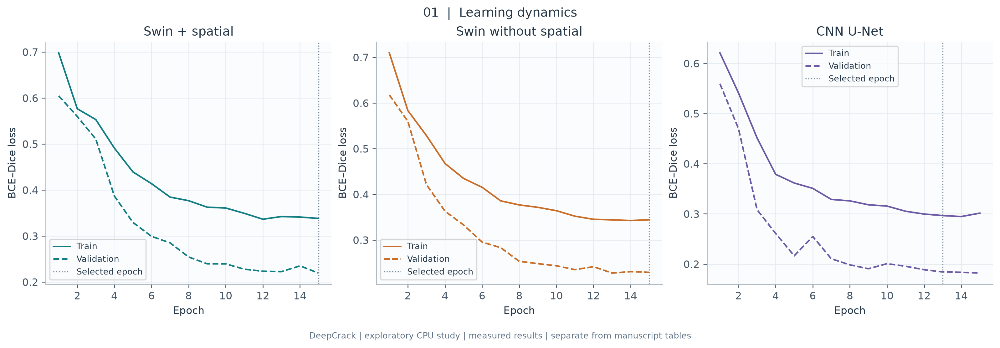
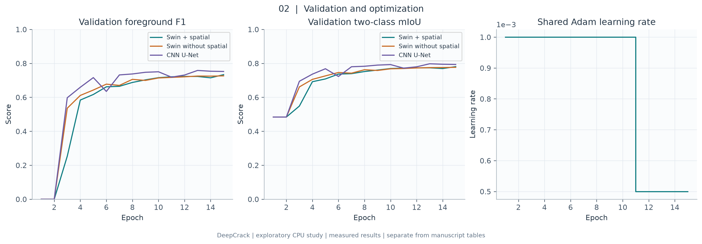
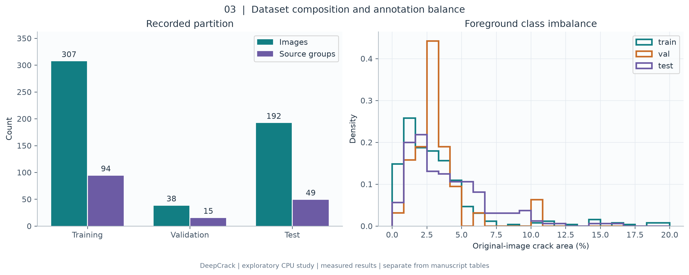
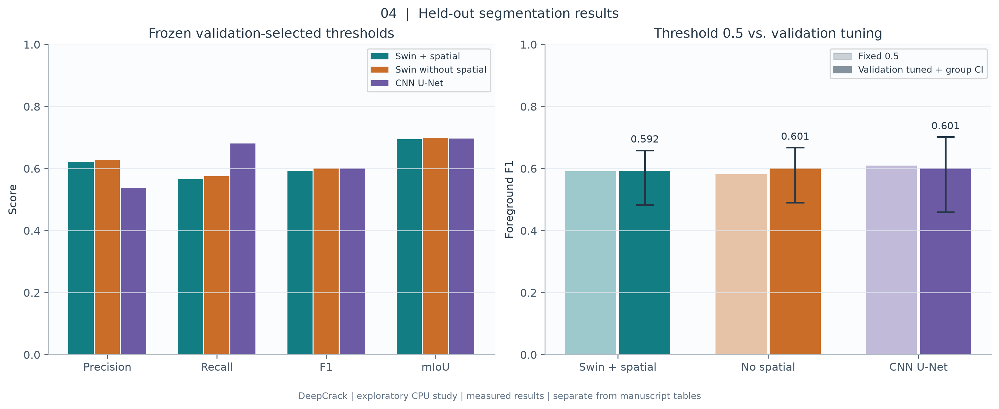
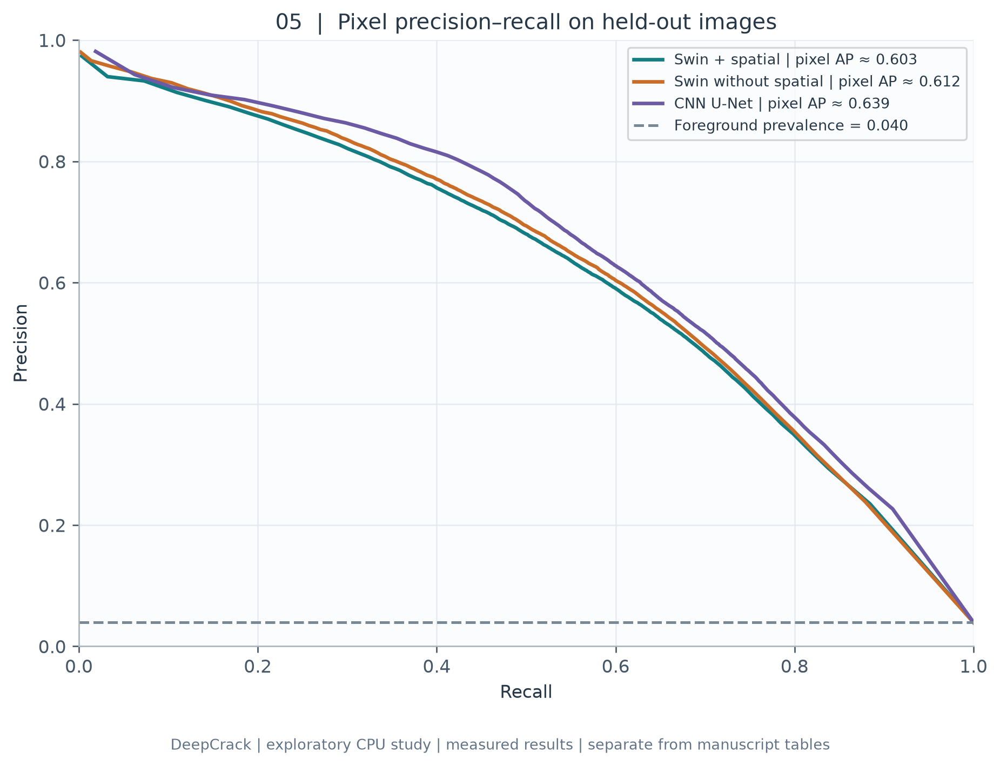
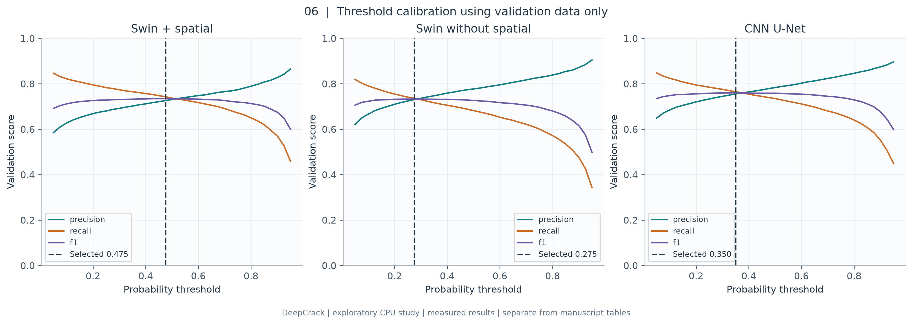
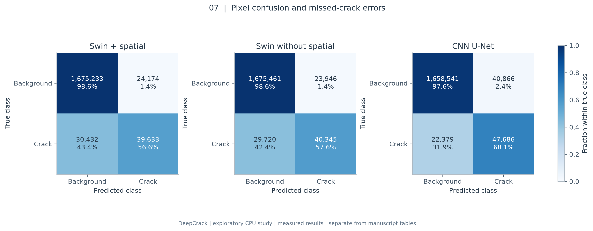
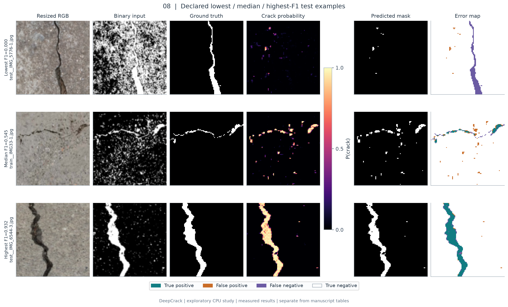
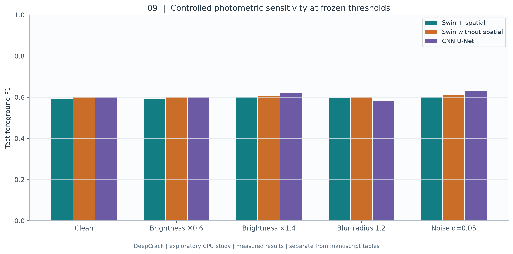
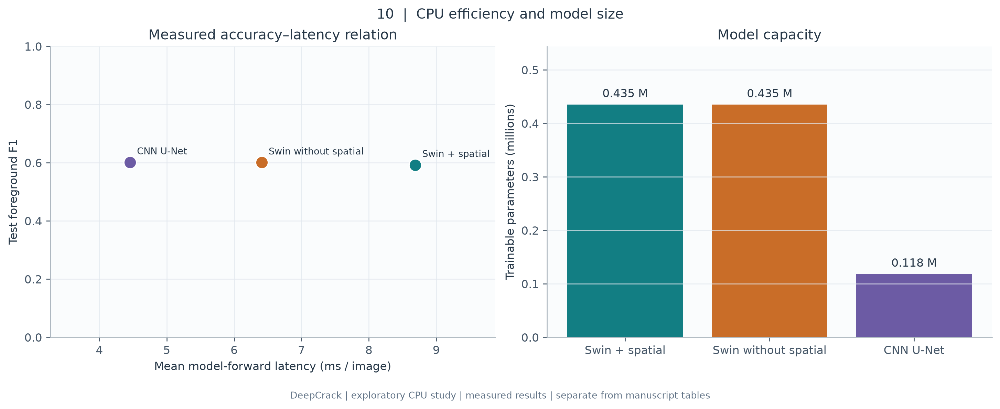

# Crack Vision Net — measured research results

We completed a matched three-model exploratory study on the 537-image author-hosted DeepCrack archive and generated ten scientific figures from measured outputs. This study extends the initial software checks into learning, segmentation, threshold calibration, visual error analysis, perturbation sensitivity and efficiency measurements. It is distinct from reproducing the manuscript’s five-dataset tables.

## Experimental protocol

All three models use the same 307 training, 38 validation and 192 held-out test images, the recorded source-group split, seed 42, binary Otsu input preprocessing, augmentation, BCE–Dice objective, Adam optimizer, batch size 8, 96×96 evaluation resolution and 15 epochs. The exploratory initial learning rate is 0.001 and halves after ten epochs. The Swin model configuration is {'name': 'swin', 'embed_dim': 12, 'depths': [2, 2, 2, 2], 'heads': [3, 3, 6, 12], 'window': 4, 'spatial_attention': True}. The CNN U-Net uses base width 16. These settings were declared before these runs and differ from the 34.3-million-parameter, 50-epoch manuscript configuration.

We select each checkpoint by validation mIoU at threshold 0.5. A second, explicitly reported operating threshold maximizes validation F1 over a fixed grid from 0.05 to 0.95 in increments of 0.025. Ties favor the value nearest 0.5. We freeze this value before final test evaluation. We report both fixed-threshold and calibrated results, rather than selecting a threshold using the test precision–recall curve.

## Numerical results

| Model | Selected epoch | Val-selected threshold | Test precision | Test recall | Test F1 | Test mIoU | 95% group-bootstrap F1 interval |
|---|---:|---:|---:|---:|---:|---:|---|
| Swin + spatial | 15 | 0.475 | 0.6211 | 0.5657 | 0.5921 | 0.6945 | [0.4829, 0.6588] |
| Swin without spatial | 15 | 0.275 | 0.6275 | 0.5758 | 0.6006 | 0.6991 | [0.4900, 0.6676] |
| CNN U-Net | 13 | 0.350 | 0.5385 | 0.6806 | 0.6013 | 0.6966 | [0.4600, 0.7015] |

The compact Swin model with spatial refinement achieved test F1 **0.5921** and two-class mIoU **0.6945** at its validation-selected threshold **0.475**. Its test F1 interval was [0.4829, 0.6588]. This interval comes from 1,000 resamples of source groups and preserves dependence among crops within a group. It is conditional on one trained model and cannot estimate variation across random training seeds.

## Interpretation and comparison

The measured Swin + spatial F1 difference relative to Swin without spatial was -0.0085. This observed difference belongs to the compact, single-seed protocol. It does not establish general superiority or reproduce the manuscript’s baseline comparisons.
The measured Swin + spatial F1 difference relative to CNN U-Net was -0.0092. This observed difference belongs to the compact, single-seed protocol. It does not establish general superiority or reproduce the manuscript’s baseline comparisons.

The spatial gate did not improve test F1 in this exploratory run. The group-bootstrap intervals overlap substantially, and this single-seed study does not establish an accuracy advantage for that component. The validation-to-test gap also cautions against relying on validation curves alone.

Pixel accuracy is influenced strongly by background prevalence. Foreground F1, recall, precision and crack IoU should therefore be examined jointly. The reported mIoU averages the background and foreground IoUs; it is not simply foreground IoU and is not the half-foreground expression appearing in the source document. Pixel AP in these reports uses 256 probability bins and is not instance-detection mAP.

The qualitative montage deliberately includes the lowest-, median- and highest-F1 test images. This exposes failures and typical behavior alongside a successful case. The complete per-image numerical results accompany the analysis JSON, avoiding reliance on a hand-picked favorable montage. Thin structures can be lost during resizing, and connected textures can create false positives. The figure captions identify exact axes, selection rules and measurement conditions.

The perturbation experiments change the input image before the full preprocessing chain while leaving labels and operating thresholds fixed. Otsu thresholding can partly normalize global illumination, but clipping, blur and additive noise can alter thin crack boundaries. These controlled checks measure specific sensitivities; they do not substitute for geographically independent datasets, night imagery or natural weather measurements.

Forward latency uses the same CPU, two threads, batch one and configured input resolution for all three models, with five warmups and thirty measured iterations. It excludes decoding, preprocessing and serialization. The efficiency plot is consequently an architecture comparison within this environment, rather than an end-to-end vehicle throughput claim.

## Figure-by-figure results

### Figure 1. Learning curves

Training and validation BCE–Dice losses for all three matched runs. Curves cover the complete recorded training histories; augmentation affects training only. Checkpoint selection uses validation mIoU, not the minimum test loss. A widening train–validation gap would indicate overfitting; loss magnitude alone does not establish crack localization quality.

### Figure 2. Validation learning

Validation F1, two-class mIoU and the learning-rate schedule. Threshold 0.5 is fixed during model selection. Background-heavy mIoU can remain near 0.5 even when foreground F1 is zero. The learning rate halves after epoch 10; this setting is shared across models.

### Figure 3. Dataset composition

Image counts and source-group counts for the recorded train/validation/test split, together with distributions of original-resolution foreground fractions. The counts are computed from the analyzed manifest. Groups come from the recorded filename heuristic; differences between group and image proportions reflect correlated crops. The histogram shows why pixel accuracy must be interpreted alongside foreground F1.

### Figure 4. Measured segmentation results

Precision, recall, F1 and mIoU on the held-out test images; the right panel contrasts threshold 0.5 with thresholds selected using the validation images only. Whiskers show source-group bootstrap 95% percentile intervals for tuned test F1 (1,000 resamples). Swin + spatial achieved F1=0.592 and mIoU=0.694 at threshold 0.475. Intervals describe test-group sampling uncertainty conditional on one fitted model, not training-seed variation.

### Figure 5. Precision–recall curves

Test-set pixel precision–recall curves from 256 probability bins. Legend AP is explicitly the binned pixel AP approximation; it is not object mAP@0.5. The dashed line gives the test pixel foreground prevalence, a random-ranking reference. This descriptive test curve does not select the deployed threshold.

### Figure 6. Validation threshold selection

Validation precision, recall and F1 across the declared threshold grid (0.05–0.95, step 0.025). Each dashed vertical line marks the validation-F1 optimum, with deterministic tie handling. That value is frozen before test evaluation. Thresholds should be recalibrated on a validation population matching any new deployment domain.

### Figure 7. Confusion matrices

Pixel confusion matrices at the frozen validation-selected thresholds. Rows indicate true background/crack and columns predicted background/crack. Color is normalized within each true class; annotations retain raw pixel counts and row percentages. This makes missed cracks visible despite the much larger background class.

### Figure 8. Qualitative predictions

Three held-out Swin examples chosen by a declared rule: lowest, median and highest per-image test F1. Columns show resized RGB input, binary model input, ground truth, crack probability, predicted mask and an error map. Error colors: teal=true positive, orange=false positive, purple=false negative, white=true negative. Ranking is descriptive and intentionally includes a failure; the displayed images are not an unbiased random sample. Source imagery and annotations: Liu et al., DeepCrack (2019), under upstream terms.

### Figure 9. Photometric stress tests

Test F1 under deterministic brightness factors 0.6 and 1.4, Gaussian blur radius 1.2, and Gaussian RGB noise with standard deviation 0.05 on [0,1]. Perturbations occur before the trained grayscale/denoising/Otsu pipeline; labels and the selected threshold stay fixed. These are controlled sensitivity checks, not proof of real weather or cross-country robustness. Shared per-image random seeds make noise comparisons reproducible.

### Figure 10. Accuracy and efficiency

Single-device batch-one forward latency and model size at the same configured input resolution. The scatter relates measured test F1 to mean latency; the second panel reports trainable parameters. Timing uses 5 warmups, 30 measured iterations and 2 CPU threads, excluding image decoding, preprocessing and output writing. Architecture size and CPU throughput must not be compared directly with the manuscript RTX3090 full-model claims.

## Reproducibility and remaining research scope

The repository stores the declared configuration, numerical analysis JSON, CSV results, training histories, checkpoint hashes, data audit and figure source code. Use `python scripts/run_research_study.py --manifest data/deepcrack/manifest.csv --runs runs/research_cpu --analysis reports/research_cpu --figures figures` to repeat training, analysis and plotting. The source dataset and trained checkpoints stay outside version control. Recreate the qualitative arrays by running analysis against the same dataset; the published montage is also included.

Before using these results as paper-level evidence, verify the filename-based acquisition groups against source metadata, repeat multiple training seeds, restore the manuscript-size architecture and 50-epoch schedule, run the other four datasets with reviewed pixel labels, and evaluate original comparison methods under a common protocol. RDD2022 boxes do not define pixel segmentation ground truth. Physical crack widths require calibrated pixel-to-world scale. These requirements delineate the scientific conclusions supported by the current experiment.

## Attribution

DeepCrack imagery and annotations: Liu, Yao, Lu, Xie and Li, *DeepCrack: A Deep Hierarchical Feature Learning Architecture for Crack Segmentation*, Neurocomputing 338 (2019), DOI 10.1016/j.neucom.2019.01.036. The derived visual panels retain the upstream dataset terms. Original code is licensed separately under MIT.
